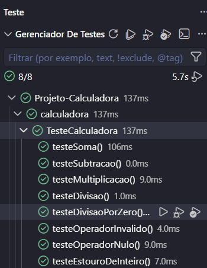

# projeto_calculadora

Módulo de cálculos matemáticos básicos em Java, desenvolvido para a startup fictícia **FinançApp**, um aplicativo mobile de controle de finanças pessoais.

---

## 📌 Descrição do Projeto

O projeto consiste em uma calculadora capaz de realizar as quatro operações matemáticas básicas entre números inteiros. Ela será utilizada em funcionalidades do aplicativo, como:

- cálculo de orçamento mensal;
- divisão de despesas;
- projeção de economia financeira;
- cálculo de valores básicos utilizados pelo sistema.

A classe `Calculadora` recebe dois números inteiros e um operador, e sempre retorna uma mensagem em texto, sem interromper a execução do programa, mesmo em casos de erro.

---

## 🎯 Objetivo da Atividade

Desenvolver a capacidade prática de construção, validação, manutenção e documentação de software, aplicando:

- testes funcionais e testes unitários;
- tratamento de erros;
- refatoração de código;
- documentação técnica (JavaDoc);
- versionamento com Git e GitHub.

---

## 🛠️ Tecnologias Utilizadas

| Tecnologia | Uso |
|---|---|
| Java | Linguagem de programação |
| JUnit 5 | Testes unitários |
| JavaDoc | Geração da documentação técnica em HTML |
| Git | Controle de versão |
| GitHub | Repositório remoto |

---

## 📁 Estrutura do Projeto

```
projeto_calculadora/
├── src/
│   └── calculadora/
│       ├── Calculadora.java
│       └── TesteCalculadora.java
├── docs/
│   └── index.html
├── prints/
└── README.md
```

---

## ➗ Explicação das Operações

O método principal é `calc(int a, int b, String op)`, onde `a` e `b` são os operandos e `op` é o operador.

| Operador | Operação | Exemplo | Retorno |
|---|---|---|---|
| `+` | Soma | `calc(5, 3, "+")` | `Resultado: 8` |
| `-` | Subtração | `calc(10, 4, "-")` | `Resultado: 6` |
| `*` | Multiplicação | `calc(6, 7, "*")` | `Resultado: 42` |
| `/` | Divisão | `calc(20, 5, "/")` | `Resultado: 4` |

### Tratamento de erros

| Situação | Exemplo | Retorno |
|---|---|---|
| Divisão por zero | `calc(10, 0, "/")` | `Não é possível divisão por 0` |
| Operador inválido | `calc(2, 3, "%")` | `Operador inválido, tente (+, -, / ou *)` |
| Operador nulo | `calc(2, 3, null)` | `Operador inválido, tente (+, -, / ou *)` |
| Estouro do tipo `int` | `calc(Integer.MAX_VALUE, 1, "+")` | `Resultado fora do limite permitido` |

---

## 🔄 Refatoração

O processo de refatoração foi feito na branch **`Refatoracao`**, aplicando:

- extração de métodos (`somar`, `subtrair`, `multiplicar`, `dividir` e `formatar`);
- criação de constantes para as mensagens, evitando textos repetidos;
- melhoria na legibilidade e na organização lógica do código;
- simplificação das estruturas condicionais com `switch`.

Após a refatoração, todos os testes foram executados novamente e continuaram passando, comprovando que o comportamento do sistema não foi alterado.

### Branches

- `main`: versão inicial, com a implementação funcional;
- `Refatoracao`: versão refatorada e documentada.

---

## 🧪 Testes Unitários

A classe `TesteCalculadora` contém testes para:

- soma;
- subtração;
- multiplicação;
- divisão;
- divisão por zero;
- operador inválido;
- operador nulo;
- estouro de inteiro.

Cada teste exibe no console as **entradas utilizadas**, o **resultado esperado** e o **resultado obtido**.

### Prints da execução dos testes

![Execução dos testes]

---

## 🔗 Link do Repositório

(https://github.com/joaovitorsann/ProjetoCalculadora)

---

## 👤 Autor

**João Vitor Alves dos Santos**
